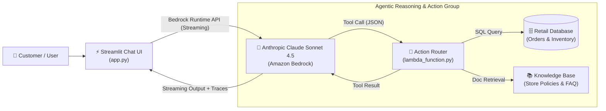

# ⚡ Nova: Autonomous Retail AI Agent with Amazon Bedrock

[](https://python.org)
[](https://aws.amazon.com/bedrock/)
[](https://www.anthropic.com/claude)
[](https://streamlit.io)
[](LICENSE)

**Nova** is an end-to-end autonomous customer support and order management AI agent powered by **Amazon Bedrock (Anthropic Claude Sonnet 4.5)**, **AWS Lambda Action Groups**, **OpenAPI 3.0 schemas**, and a modern **1-Page Streamlit Chat UI**.

The agent autonomously reasons across customer queries, determines when database or business logic actions are needed, executes tool invocations against backend Lambda handlers, and delivers conversational streaming responses with execution traces.

---

## 📌 Architecture Overview



---

## 🌟 Key Features & Capabilities

- 🤖 **Agentic Tool Calling**: Automatically calls tools (`getOrder`, `cancelOrder`, `listProducts`, `getProduct`, `searchKnowledgeBase`) based on natural language intent.
- 📦 **Order Management**: Real-time status lookup, delivery estimates, and cancellation with automated refund calculations.
- 🎧 **Product Catalog & Stock**: Live inventory checks with fallback recommendations for out-of-stock items.
- 📖 **Knowledge Base Retrieval**: Cites store return windows, warranty terms, and shipping FAQs.
- 🔍 **Execution Trace Inspector**: Transparent chain-of-thought and tool input/output JSON inspection right inside the UI.
- ⚡ **Dual Operating Modes**:
  - **Live AWS Bedrock**: Connects directly to Amazon Bedrock with low-budget pay-as-you-go serverless inference (~$0.0008 per query).
  - **Offline Local Simulator**: $0.00 cost mode enabling testing of backend Lambda and SQLite without calling AWS APIs.

---

## 💼 Skills Showcased (For Resume & Portfolio)

- **Generative AI & LLM Orchestration**: Amazon Bedrock, Anthropic Claude Sonnet, Tool Calling, System Prompt Engineering.
- **Cloud Architecture & Serverless**: AWS Lambda, IAM policies, Boto3 SDK, Bedrock Runtime API, Inference Profiles.
- **API Design & Standards**: OpenAPI 3.0 specification, RESTful dispatching, JSON schema validation.
- **Frontend & Full-Stack Development**: Python 3.12, Streamlit reactive UI, Server-Sent streaming, Session State management.

> 📝 **Resume Bullet Point Suggestion:**
> *Designed and implemented an autonomous AI customer support assistant using Amazon Bedrock (Claude Sonnet 4.5) and AWS Lambda, featuring OpenAPI-driven tool calling, real-time streaming, and interactive trace inspection within a Streamlit interface.*

---

## 📂 Repository Structure

```
├── backend_lambda/              # Backend Lambda & Database
│   ├── database.py              # SQLite store (orders, catalog, inventory)
│   ├── lambda_combined.py       # Single-file handler ready for AWS Lambda Console
│   ├── lambda_function.py       # Modular Bedrock Action Group Lambda Handler
│   └── test_lambda_local.py     # Offline test harness for Lambda logic
│
├── schemas/                     # API Definitions
│   └── openapi_schema.json      # OpenAPI 3.0 schema for Bedrock Action Group
│
├── bedrock_agent/               # Agent Configuration & Knowledge Base
│   ├── agent_instructions.txt   # System prompt and persona guidelines
│   ├── deploy_agent.py          # Automated Boto3 deployment script
│   └── knowledge_base_docs/     # Markdown policy docs for Bedrock Knowledge Base
│       ├── return_policy.md
│       └── shipping_and_delivery.md
│
├── ui/                          # Frontend Application
│   ├── app.py                   # 1-Page Streamlit Chat Application
│   └── bedrock_service.py       # Bedrock Converse client & offline simulator
│
├── scripts/                     # Utility & Diagnostic Scripts
│   ├── check_models.py          # Lists available Anthropic foundation models
│   ├── check_profiles.py        # Lists AWS Bedrock inference profiles
│   ├── find_active_model.py     # Discovers active models in current account
│   ├── test_claude_call.py      # Tests standalone Bedrock invocation
│   └── test_tool_calling.py     # Tests live Claude Sonnet 4.5 tool execution
│
├── tests/                       # Test Suite
│   └── test_end_to_end.py       # E2E integration tests (schemas, DB, mock runner)
│
├── .env.example                 # Configuration template (keys kept safe)
├── .gitignore                   # Excludes .env, virtual environments, and caches
└── requirements.txt             # Python dependencies
```

---

## 🚀 Quick Start Guide

### 1. Clone the Repository
```bash
git clone https://github.com/BoopathiM9/Nova-Bedrock-AI-Agent.git
cd Nova-Bedrock-AI-Agent
```

### 2. Set Up Virtual Environment & Dependencies
```bash
# Windows
python -m venv .venv
.\.venv\Scripts\Activate.ps1
pip install -r requirements.txt

# macOS / Linux
python3 -m venv .venv
source .venv/bin/activate
pip install -r requirements.txt
```

### 3. Configure Environment Variables
Copy the template:
```bash
cp .env.example .env
```
Add your AWS credentials to `.env`:
```ini
AWS_REGION=us-east-1
AWS_ACCESS_KEY_ID=your_access_key_here
AWS_SECRET_ACCESS_KEY=your_secret_access_key_here
```

### 4. Run the Streamlit UI
```bash
streamlit run ui/app.py
```
Open [http://localhost:8501](http://localhost:8501) in your browser!

---

## 🧪 Testing Prompts

Try these sample prompts in the chat interface:
1. **Order Status**: `"Where is my order ORD-1001?"`
2. **Product Stock**: `"Check stock for Titan Wireless Headphones"`
3. **Store Policies**: `"What is your return & refund policy?"`
4. **Order Cancellation**: `"Cancel order ORD-1003"`

---

## 📄 License
This project is licensed under the [MIT License](LICENSE).
